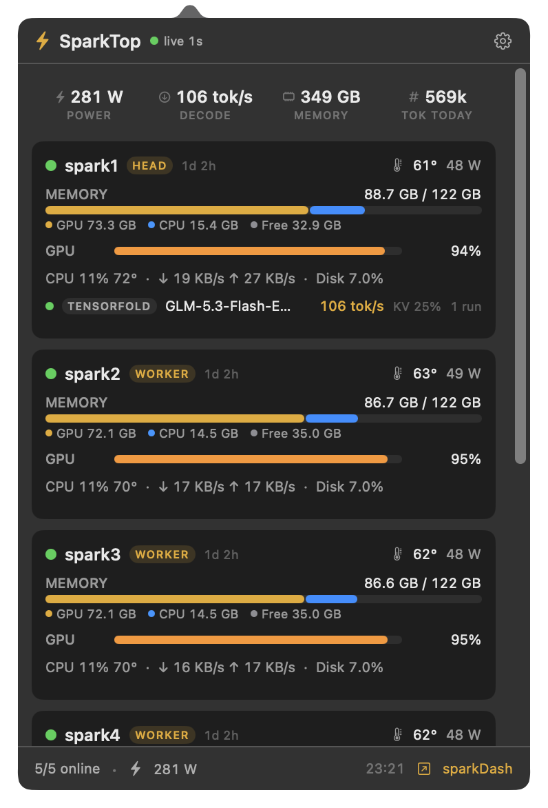
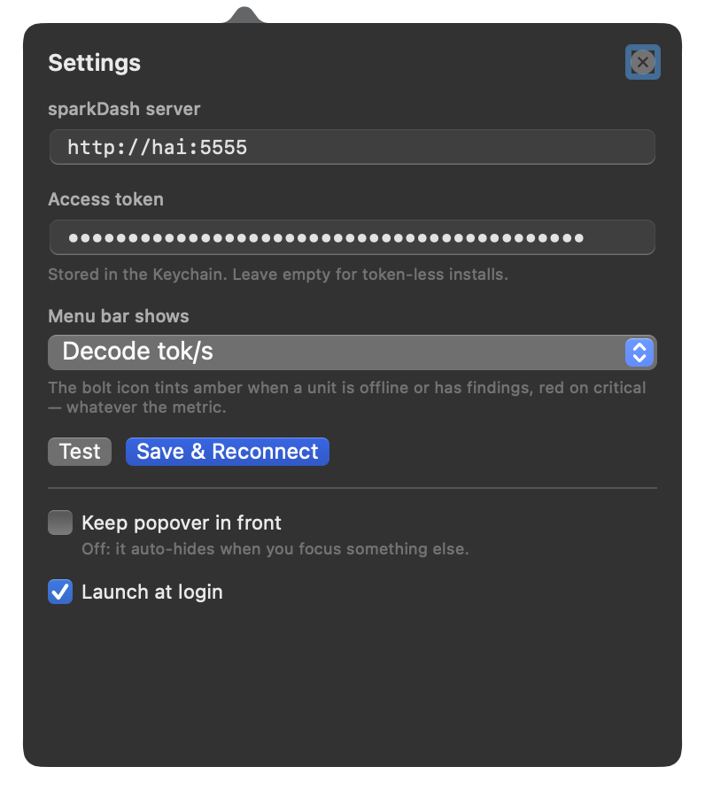

# SparkTop

A native macOS **menu bar app** that shows your [sparkDash](https://github.com/MiaAI-Lab/sparkDash) fleet at a glance: a live `⚡` item in the menu bar and a rich fleet overview in the popover.

<p align="center">
  
</p>
<p align="center">
  <em>Menu bar icon — live decode rate while a model is serving, and idle. The item keeps a sticky width (grows for wider values, never shrinks back), and the value is right-aligned so the unit never moves.</em><br><br>
  
  &nbsp;&nbsp;
  
</p>

SparkTop is a **thin client** — sparkDash stays the single source of truth. It connects to your sparkDash server over WebSocket (`/ws`), renders the live snapshot natively in SwiftUI, and polls a couple of REST endpoints (`/api/llm-token-totals/history`, `/api/events`) for fleet-level stats. No SSH credentials ever leave the sparkDash server.

## Features

- **Menu bar item** with a live metric of your choice (Settings → *Menu bar shows*):
  - Fleet power (GPU draw, e.g. `⚡ 267W`)
  - Busiest GPU `94%`
  - Decode `82 t/s`
  - Memory in use `290G`
  - Icon only
- **Color states**: amber when a unit is offline or has health findings, red on critical findings or when sparkDash is unreachable.
- **Fleet overview popover**: per-unit cards (GPU/temp/power, unified-memory split GPU/CPU/free, CPU, network, disk, LLM backend/model/tok/s/KV-cache/requests, health findings) plus a fleet strip (power · decode · memory · tokens today) and the last activity events.
- **Right-click menu** on the bolt: *Open sparkDash*, *Settings…*, *Quit*. Left-click toggles the popover (the footer's `↗ sparkDash` also opens the full dashboard in your browser).
- **Robust connection**: WebSocket with exponential-backoff reconnect, stale-stream watchdog, ping keepalive; a rejected token is detected via `GET /api/health` and shown as *auth failed* instead of retrying forever.
- **Settings** (gear icon): server URL, access token (Keychain-backed, with an on-disk cache so startup never blocks), menu bar metric, popover behavior (*keep in front* vs *auto-hide on losing focus*), launch at login (SMAppService).
- Fully native AppKit + SwiftUI, ~900 KB binary, no Electron/webview.

## Build

```bash
./build.sh              # → dist/SparkTop.app (ad-hoc signed)
./build.sh --install    # → /Applications/SparkTop.app
./build.sh --open       # build & launch with the popover open (debug)
./build.sh --open --pin # same, but the popover stays pinned (screenshots)
```

Requires Xcode/Swift toolchain (macOS 13+ target).

## Configure

First launch: click the bolt → gear → set the sparkDash URL (e.g. `http://hai:5555`) and paste the access token (`SPARKDASH_TOKEN` of your server). *Test* verifies reachability and auth mode; *Save & Reconnect* applies.

<p align="center">
  
</p>

The token is stored in the login Keychain (with a fast startup cache in `defaults` domain `com.sparktop.menubar`). To pre-seed it:

```bash
defaults write com.sparktop.menubar sparkdash-token-cache '<token>'
```

## Layout

```
Sources/SparkTop/
├── main.swift            # AppKit entry: NSApplication + NSPopover wiring
├── Models.swift          # sparkDash snapshot/event decoding (tolerant, optional fields)
├── Settings.swift        # URL/token/metric persistence + Keychain wrapper
├── SnapshotStore.swift   # WebSocket client (reconnect/watchdog) + REST polls
├── StatusItem.swift      # NSStatusItem: metric text, tints, right-click menu
└── Views/
    ├── OverviewView.swift   # fleet strip, cards, activity, footer
    ├── SparkCardView.swift  # per-unit card
    ├── SettingsView.swift   # settings pane
    └── Components.swift     # bars, chips, formatters
```

## Notes

- Plain-HTTP servers are supported (sparkDash on the LAN / over Tailscale); `NSAllowsArbitraryLoads` is enabled for that reason.
- The `reference/ws-snapshot-sample.json` file documents the snapshot shape the UI decodes.
- sparkDash ≥ 2.x with the standard `/ws` + REST API. Anything missing in the payload degrades to `—` rather than breaking.
